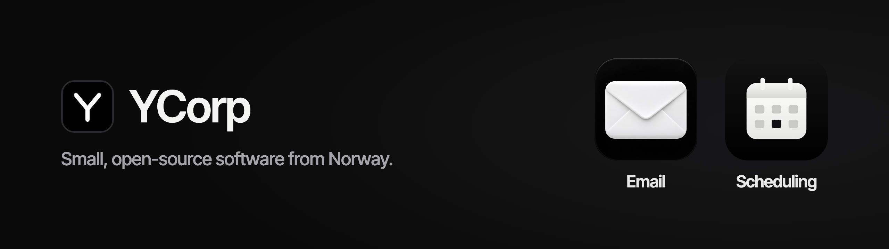

<table>
<tr>
<td width="50%" valign="top">

**[Email](https://github.com/YCorpLabs/Email)**

A fast, native email client for Mac and Linux. Keyboard-first, private by default, and your own agent can help out, but only with the access you give it.

[Code](https://github.com/YCorpLabs/Email) · [Website](https://ycorplabs.com/email/)

</td>
<td width="50%" valign="top">

**[Scheduling](https://github.com/YCorpLabs/Scheduling)**

Open-source team scheduling: booking links, team links that rotate between hosts, approvals and reminders. Use ours, or host your own on Cloudflare.

[Code](https://github.com/YCorpLabs/Scheduling) · [Try it](https://meet.ycorplabs.com/)

</td>
</tr>
</table>

Both are in beta. Try them, break them, and tell us what's missing: open an issue, or email feedback@ycorplabs.com.
